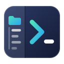
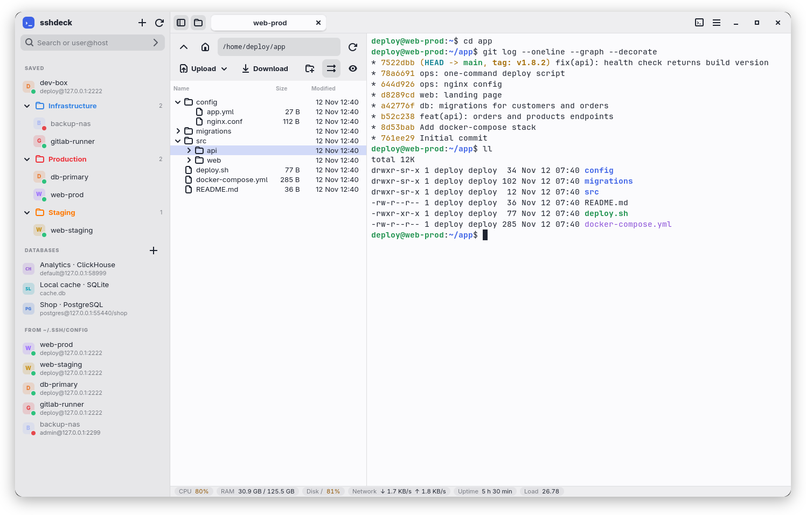
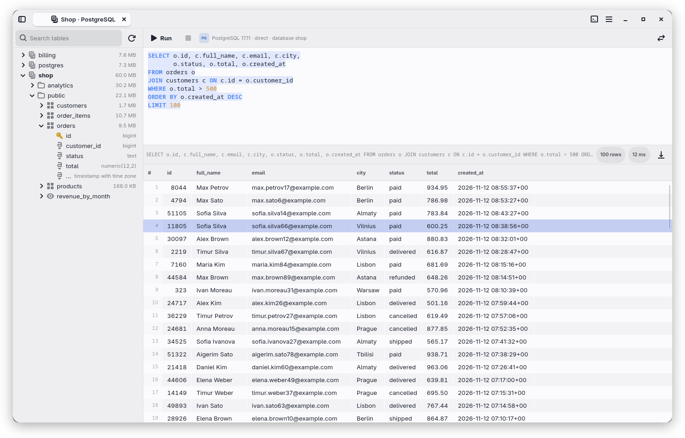
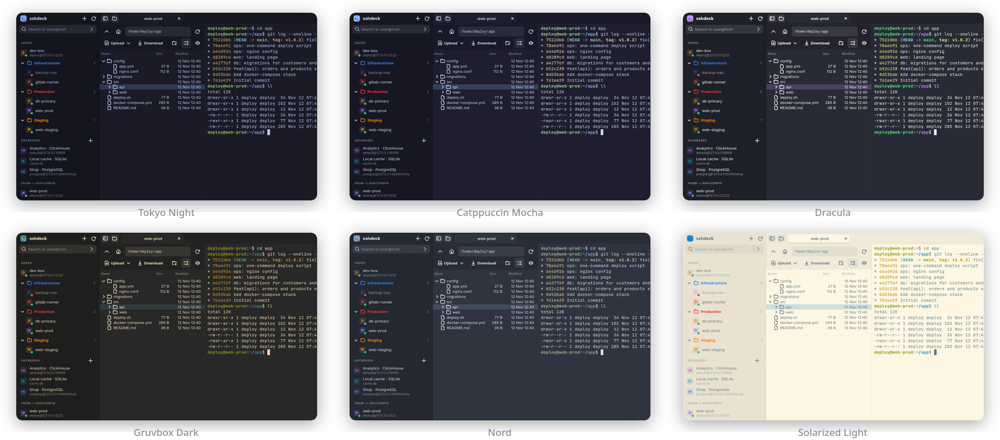
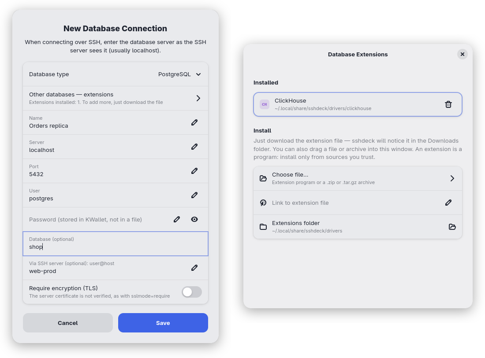

<div align="center">



# sshdeck

**A lightweight native SSH client for Linux: SFTP file tree, terminal and database client in one window.**

[](https://www.rust-lang.org/)
[](https://gtk.org/)
[](#installation)
[](LICENSE)

**English** · [Русский](README.ru.md)

<br>

<picture>
  <source media="(prefers-color-scheme: dark)" srcset="docs/screenshots/en/main-dark.png">
  
</picture>

</div>

sshdeck is inspired by MobaXterm. Each tab puts the remote server's files (over SFTP) next to an SSH terminal, and a status bar shows the server's CPU, memory and disk. It is a native GTK 4 + libadwaita app written in Rust, with no Electron. It also has its own look: tabs live in the title bar, servers get colored badges, and it ships its own light and dark palettes.

sshdeck does **not** implement SSH itself. The terminal runs your system `/usr/bin/ssh`, so `~/.ssh/config`, keys, `ssh-agent`, `ProxyJump` and password prompts behave exactly as they do in a regular terminal. The app never reads, stores or logs SSH passwords or key passphrases.

> [!NOTE]
> The interface is available in English, Russian and Spanish. By default it follows the system language; to change it, use *Menu → Language*. The screenshots show demo data.

## Contents

- [Highlights](#highlights)
- [Screenshots](#screenshots)
- [Installation](#installation)
- [Usage](#usage)
- [Database client](#database-client)
- [Keyboard shortcuts](#keyboard-shortcuts)
- [How it works](#how-it-works)
- [Files and settings](#files-and-settings)
- [Translations](#translations)
- [Known limitations](#known-limitations)

## Highlights

| | |
|---|---|
| 🗂️ **Files and terminal side by side** | The SFTP tree on the left follows the shell's `cd`. Drag and drop works both ways. A remote file opens in your local editor and is uploaded again every time you save. |
| 🔐 **Real OpenSSH, one login** | You type the password once, in the terminal. The file panel and further tabs to the same server reuse that connection through `ControlMaster`, so they never ask again. |
| 🔀 **Port forwarding** | Local, remote and SOCKS forwards over the tab's connection, with a status for each. They can be saved with a connection and come back after a reconnect. |
| 🗄️ **Built-in database client** | PostgreSQL, MySQL/MariaDB and SQLite work out of the box. Any other database can be added with an extension. It supports SSH tunnels, CSV/JSON/SQL import and export, and saves passwords in KWallet or GNOME Keyring. |
| 📁 **Organised connections** | Saved connections go into folders, and folders can be colored. Hosts from `~/.ssh/config` are listed too, along with quick connect and search. Each server shows whether it is online. |
| 📊 **Server at a glance** | The status bar shows CPU, memory, disk, network speed, uptime and load average, and highlights values above 75 % and 90 %. |
| 🎨 **Themes** | The app has its own light and dark palettes plus Dracula, Nord, Gruvbox, Tokyo Night, One Dark, Catppuccin and Solarized. A theme recolors the whole app, not only the terminal. |
| 🌍 **Three languages** | The interface is available in English, Russian and Spanish, and GTK's own dialogs follow the same choice. |
| ⚡ **Light and fast** | It is written in Rust, and all networking runs on a separate tokio runtime, so a slow network never freezes the interface. |

## Screenshots

### Database client

<picture>
  <source media="(prefers-color-scheme: dark)" srcset="docs/screenshots/en/database-dark.png">
  
</picture>

### Themes



### Database connection and extensions

<p align="center">
  
</p>

## Installation

### Dependencies

| Package | Why it is needed |
|---|---|
| GTK ≥ 4.16 | user interface (uses CSS variables in styles) |
| libadwaita ≥ 1.6 | tabs, dialogs, toasts |
| VTE ≥ 0.72 (GTK 4 build) | terminal widget |
| OpenSSH client | `/usr/bin/ssh` makes every connection |
| `xdg-utils` | `xdg-open` opens remote files in a local editor |
| SQLite, OpenSSL | database client |
| Rust (edition 2024) | building (tested with Rust 1.99) |

The server only needs the SFTP subsystem, which OpenSSH enables by default.

**Arch / CachyOS** (the tested platform):

```sh
sudo pacman -S --needed gtk4 libadwaita vte4 openssh xdg-utils sqlite openssl rust
```

<details>
<summary>Debian / Ubuntu and Fedora package names (not tested)</summary>

You need a release with GTK ≥ 4.16, for example Debian 13 or Fedora 41 or later.

```sh
# Debian / Ubuntu
sudo apt install libgtk-4-dev libadwaita-1-dev libvte-2.91-gtk4-dev \
                 libsqlite3-dev libssl-dev pkg-config openssh-client xdg-utils
# Fedora
sudo dnf install gtk4-devel libadwaita-devel vte291-gtk4-devel \
                 sqlite-devel openssl-devel openssh-clients xdg-utils
```

Install Rust with [rustup](https://rustup.rs/).
</details>

### Build and run

```sh
git clone https://github.com/ylkhn1/sshdeck.git
cd sshdeck
cargo build --release

./target/release/sshdeck            # window with the host list
./target/release/sshdeck myhost     # open a tab right away (several hosts are allowed)
```

### Install for the current user

This installs the binary, a menu entry and the icon, without `sudo`. `~/.local/bin` must be in your `PATH`.

```sh
install -Dm755 target/release/sshdeck ~/.local/bin/sshdeck
install -Dm644 data/dev.sshdeck.App.desktop ~/.local/share/applications/dev.sshdeck.App.desktop
install -Dm644 data/dev.sshdeck.App.svg ~/.local/share/icons/hicolor/scalable/apps/dev.sshdeck.App.svg
update-desktop-database ~/.local/share/applications
```

### Checks

```sh
cargo test                  # unit tests (ssh config parsing, ssh command lines, paths, SQL, formats)
cargo clippy --all-targets  # no warnings
```

## Usage

### Connections

- **Quick connect.** Type `user@host` or an alias into the field at the top of the sidebar. You can give a port the way `ssh` does (`user@host -p 2222`) or after a colon (`user@host:2222`, `ssh://user@host:2222`). Other `ssh` options are not accepted in this field.
- **Saved connections.** The **+** button saves a connection with a name, an address and an optional folder. Double-click a connection to open a tab with that name. Right-click it to connect, edit, duplicate or delete. A host from `~/.ssh/config` can be saved from its context menu.
- **Folders.** Folders can be nested, for example `Work/Servers`. A folder appears when you save the first connection into it and disappears with the last one. Click a folder to collapse it; collapsed folders stay collapsed after a restart. Its context menu lets you add a connection to it, rename it, pick one of seven colors, remove the folder and move its contents up one level, or delete it with everything in it.
- **Order.** Connections and folders stay in the order you give them. Drag them in the sidebar, or use *Move Up*, *Move Down* and *Move to Folder…* in the context menu.
- **Hosts from `~/.ssh/config`.** `Host` entries are listed below the saved connections. Wildcard entries are skipped, and `Include` is followed.
- **Search.** The same field filters connections by name, address and folder. Matches are shown inside their folders.
- **Status dots.** sshdeck checks each server by reading its `SSH-…` greeting, without logging in. The hover tooltip shows the latency.
- **Command after login.** You can set a command that runs right after login, for example `cd /srv/app`.
- **Saved commands.** The terminal button in the title bar opens a list of commands. Click one to type it into the current tab and press Enter. sshdeck never records what you type in the terminal, because that would capture passwords.
- **Import and export.** *Menu → Export Connections…* saves all saved connections and folders, with their colors, commands after login and port forwards, to a JSON file; it never contains passwords. *Menu → Import Connections…* adds connections from such a file or from an ssh config file taken from another machine (for those, only the address, user and port are used). Connections already in the same folder with the same name and address are skipped, so importing the same file twice adds nothing.

### Files

- **Login.** You enter your password or key passphrase once, in the tab's terminal. The file panel waits and connects by itself as soon as you are logged in. Further tabs to the same server reuse that login. A tab opened while another one is still logging in waits for that login instead of asking again (press Enter to log in there instead).
- **Tree.** The tree starts in your home directory. Arrows expand directories in place, and their contents load on demand. Double-click a directory to enter it. The path field accepts `~`, `..` and relative paths. The **eye** button shows dotfiles.
- **Operations.** You can upload files or a whole directory, download the selection, create a directory, rename (F2), delete (Delete, after confirmation) and refresh (F5 or Ctrl+R). Directories are transferred and deleted recursively. sshdeck asks before overwriting files.
- **Drag and drop.** Drop files from your file manager onto a folder in the tree to upload them there, or anywhere else in the panel to upload them to the current directory. Drag rows out of the panel to download them.
- **Files on this computer.** The **computer** button at the top of the panel shows a local file tree above the server tree; the divider between them can be dragged. Select files in one tree and press F5 (or the copy button, or *Upload to Server* / *Download to Local Folder* in the context menu) to copy them into the folder open in the other tree, or drag them from one tree to the other. The local tree can open files and folders, create folders, rename (F2), move to the trash (Delete) and copy paths; it never deletes anything permanently. It opens in the folder you last used with this server, and the button's state is shared by all tabs and kept after a restart.
- **Transfers.** Each transfer shows its progress and a cancel button. A cancelled transfer does not leave half-written files behind. Modification times are kept in both directions, new files on the server get the permissions of the local file, and downloaded files and folders get the permissions they have on the server (without write access for group and others). Symlinks to folders are followed, with protection against loops; special files are skipped with a notice. File names that are not valid UTF-8 work too.
- **Remote editing.** Double-click a file to download it and open it with `xdg-open`. Every time you save it in the editor, it is uploaded back while the tab is open. If the file changed on the server since you opened it, sshdeck asks whether to overwrite it, save your version as a copy next to it, or keep it local.
- **Panel follows `cd`.** When the shell reports its current directory, the panel follows. fish does this out of the box. For bash and zsh, choose *Menu → File Panel Follows cd on This Server…*. This adds a few lines tagged `sshdeck-cwd` to `~/.bashrc` or `~/.zshrc` on the server; if you set it up with an older version, choose the item again to update them. Paths with spaces and non-ASCII characters work. If you hop from the server to another server, the panel stays where it is and tells you. The opposite action is *Go Here in Terminal* in the file's context menu.

### Terminal

- Ctrl+Shift+C / Ctrl+Shift+V copy and paste. Ctrl with **+**, **−** or **0** changes the zoom.
- Links and IP addresses are underlined under the mouse pointer. Ctrl+click opens a link in the browser or copies an address.
- ssh pings the server every 30 seconds so idle sessions do not drop.
- After a normal `exit` the tab closes. If the connection fails, the tab stays open with a **Reconnect** button.
- **Split terminal.** Ctrl+Shift+E opens another terminal to the right of the current one, Ctrl+Shift+O opens one below, Ctrl+Shift+W closes the current one (the same items are in the menu). Once you are logged in, a new terminal goes through the tab's connection and does not ask for the password again. Commands, snippets and *Go Here in Terminal* go to the terminal you last clicked, and the file panel follows its folder. `exit` in a split terminal closes only that terminal.
- **Passwordless login.** Choose *Menu → Passwordless Login (Key) for This Tab…* after you have logged in. sshdeck uses the key ssh would use for this server: the host's `IdentityFile` from `~/.ssh/config` if it has one, otherwise your default key (`id_ed25519`, `id_ecdsa` or `id_rsa`). If that key does not exist yet, it is created. The public key is appended to `~/.ssh/authorized_keys` on the server, skipping it if it is already there, and sshdeck then checks that key login really works.

### Port forwarding

- *Menu → Port Forwarding for This Tab…* adds local (`-L`), remote (`-R`) and dynamic SOCKS (`-D`) forwards over the tab's connection. Each forward shows whether it is active or why it failed, for example because the port is busy. Local forwards can be copied as `localhost:PORT` or opened in the browser.
- Forwards belong to the connection: tabs to the same server share them, and they are set up again after a reconnect. An icon on the tab shows their state and opens the dialog.
- A forward can be saved with a saved connection, from the dialog or in the *Port forwards* field of the connection dialog, for example `-L 8080:localhost:80, -D 1080`. Saved forwards come up automatically when you connect.

### Themes

*Menu → Theme* offers System default, Light, Dark or a colored theme. System default, Light and Dark use sshdeck's own palette rather than the stock GNOME greys, and System default follows the desktop's light or dark mode. A colored theme repaints the title bar, sidebar, lists, dialogs and terminal. The terminal font is set in *Menu → Terminal Font…*.

## Database client

The database client works in the spirit of DBeaver. It supports PostgreSQL, MySQL/MariaDB and SQLite out of the box, and any other database through extensions.

- **Connections** live in the *Databases* section of the sidebar. A connection can go through an SSH server. The tunnel comes up on its own, either through an open tab to that server or with a key.
- **Passwords** are kept in the system keyring (KWallet, GNOME Keyring), never in a file. If the server rejects a saved password, the password prompt opens on its own.
- **Tree.** It shows databases → schemas → tables and views → columns. A key icon marks the primary key. Tables show their on-disk size including indexes, and schemas and databases show their total size. The tooltip shows an approximate row count. Double-click a database to make it active.
- **Queries.** Ctrl+Enter runs the statement under the cursor, or the selection. Ctrl+Shift+Enter runs the whole text. Double-click a table to see its first 200 rows, or a result row to see the whole row.
- **Export.** Right-click a table, then choose *Export Data…* to save every row as CSV, Excel-friendly CSV (`;` separator, BOM), JSON or SQL `INSERT`s. The table is streamed, so it is never loaded into memory. A button above the result grid saves the result that is shown.
- **Import.** Import accepts CSV/TSV (the delimiter is detected automatically) or a JSON array of objects. Columns are matched by the header names. An empty field becomes `NULL`, and `""` stays an empty string. Everything runs in a single transaction, so on error the table is left untouched. You can choose to empty the table first.
- **Extensions.** A driver for another database is a standalone program in any language. Download the file or a `.zip`/`.tar.gz` archive, and sshdeck notices it in *Downloads* and offers to install it. You can also open *Database Extensions…*, then pick a file, drop it onto the window or paste a link, including a GitHub file page. Extensions are installed to `~/.local/share/sshdeck/drivers/`. An example is the [ClickHouse driver](extensions/clickhouse/sshdeck-driver-clickhouse), written in Python 3 with no dependencies. The protocol, JSON lines over stdin/stdout, is described in [extensions/README.md](extensions/README.md).

## Keyboard shortcuts

| Where | Keys | Action |
|---|---|---|
| Terminal | <kbd>Ctrl</kbd>+<kbd>Shift</kbd>+<kbd>C</kbd> / <kbd>V</kbd> | Copy / paste |
| Terminal | <kbd>Ctrl</kbd>+<kbd>+</kbd> / <kbd>−</kbd> / <kbd>0</kbd> | Zoom in / out / reset |
| Terminal | <kbd>Ctrl</kbd>+click | Open link / copy IP address |
| Terminal | <kbd>Ctrl</kbd>+<kbd>Shift</kbd>+<kbd>E</kbd> / <kbd>O</kbd> | Split the terminal to the right / down |
| Terminal | <kbd>Ctrl</kbd>+<kbd>Shift</kbd>+<kbd>W</kbd> | Close the current terminal of a split tab |
| Files | <kbd>F2</kbd> | Rename |
| Files | <kbd>Delete</kbd> | Delete (after confirmation); in the local tree, move to the trash |
| Files | <kbd>F5</kbd> | Refresh; with the local tree shown, copy the selection to the other tree |
| Files | <kbd>Ctrl</kbd>+<kbd>R</kbd> | Refresh |
| SQL editor | <kbd>Ctrl</kbd>+<kbd>Enter</kbd> | Run the statement under the cursor or the selection |
| SQL editor | <kbd>Ctrl</kbd>+<kbd>Shift</kbd>+<kbd>Enter</kbd> | Run everything |

## How it works

```
┌──────────────── tab ─────────────────┐
│  VTE terminal                        │      ssh -o ControlMaster=auto
│    └─ /usr/bin/ssh ──────────────────┼────► -o ControlPath=$XDG_RUNTIME_DIR/sshdeck/<server>
│                                      │      (you log in here, once)
│  File panel                          │
│    └─ ssh -S <socket> -s host sftp ──┼────► reuses the master connection
│  Status bar                          │
│    └─ ssh -S <socket> host <cmd> ────┼────► reads /proc every 3 s
└──────────────────────────────────────┘
```

- Tabs to the same user, host and port share one control socket in `$XDG_RUNTIME_DIR/sshdeck/`, a directory with mode 0700.
- The file panel never authenticates. It polls `ssh -O check` and, once the master is up, starts the `sftp` subsystem through it. It talks SFTP with its own small SFTP v3 client (`src/sftp/proto.rs`), which keeps file names as raw bytes and treats everything the server sends as untrusted: names that could escape the target folder are dropped, and packet sizes, tree depth and waiting times are limited.
- Port forwards are added to the master with `ssh -O forward` and removed with `-O cancel`, with `-F /dev/null`, so forwards from your `~/.ssh/config` are not touched.
- `ControlPersist=10` lets `exit` in the terminal finish right away. Closing a tab ends only its own ssh; the master is shut down with `ssh -O exit` when the last tab to that server closes. After a crash, the master goes away after 10 idle seconds.
- All networking runs on a separate tokio runtime and talks to the GTK thread over channels.
- Temporary files for editing and drag and drop live in `$XDG_RUNTIME_DIR/sshdeck/files-<pid>-<tab>/`. They are deleted when the tab closes, and anything left after a crash is cleaned up on the next start.

<details>
<summary>Source layout</summary>

```
src/
  main.rs          application entry point
  i18n.rs          interface translations: tr!/trn! macros, embedded .po catalogs
  ssh_config.rs    ~/.ssh/config parsing for the host list
  connections.rs   saved connections, nested folders, order, colors, saved forwards
  forward.rs       port forwarding: specs, validation, shared reference counts
  probe.rs         server availability check (SSH greeting, no login)
  keysetup.rs      passwordless login: key creation and installation
  remote.rs        commands on the server through the tab's master connection
  sysstat.rs       parsing server metrics for the status bar
  session.rs       control socket and ssh command lines
  settings.rs      settings: font, themes, saved commands
  sftp/            own SFTP v3 client, background task, recursive transfers with progress and cancel
  ui/window.rs     main window: tabs, menu
  ui/hosts.rs      sidebar: connections, nested folders and drag-and-drop order, ssh config hosts, databases
  ui/forwards.rs   port forwarding dialog and tab indicator
  ui/tab.rs        tab: file panel + terminal
  ui/terminal.rs   VTE terminal, themes, link and address highlighting
  ui/files.rs      file panel
  ui/statusbar.rs  server status bar
  ui/dbtab.rs      database tab: tree, SQL editor, results
  ui/databases.rs  database connections, dialog, passwords
  ui/extensions.rs extension manager window
  db/driver.rs     PostgreSQL, MySQL, SQLite and extension drivers
  db/extension*    extension discovery, protocol, installation
  db/transfer.rs   export and import formats (CSV, JSON, SQL)
  db/tunnel.rs     SSH tunnel to the database server
  db/sql.rs        SQL parsing: statement under cursor, highlighting, quoting
  db/secrets.rs    passwords in the system keyring
extensions/        extension drivers (example: ClickHouse) and the protocol
po/                Russian and Spanish translations (gettext .po)
```
</details>

## Files and settings

| Path | Contents |
|---|---|
| `~/.config/sshdeck/settings.ini` | terminal font and theme, window appearance, interface language, saved commands |
| `~/.config/sshdeck/connections.ini` | saved connections, nested folders, their order and colors, saved port forwards. It holds no passwords and can be edited by hand or copied to another machine. Files from older versions load unchanged. |
| `~/.config/sshdeck/databases.ini` | database connections (no passwords) |
| `~/.local/state/sshdeck/local-folders.ini` | the last local folder used with each server |
| `~/.local/share/sshdeck/drivers/` | installed database extensions |

`SSHDECK_SSH_CONFIG=<file>` replaces `~/.ssh/config`. The host list is read from that file, and it is passed to every `ssh` call with `-F`.

## Translations

Strings in the code are English and are wrapped in `tr!("…")`, or in `trn!` when the text depends on a number. Translations live in [`po/ru.po`](po/ru.po) and [`po/es.po`](po/es.po), standard gettext catalogs that any `.po` editor can open, such as Poedit or Lokalize. They are compiled into the binary, so nothing extra has to be installed.

`cargo test` checks that every string in the code has a translation in each catalog, that no catalog entry is left unused, and that the `{}` placeholders match. To add a language, copy `po/es.po`, translate it, and register the language in `src/i18n.rs`.

## Known limitations

<details>
<summary>This is a first version. Expand the list to see what it does not do yet.</summary>

- Linux only, and no X11 forwarding. Passwords are saved only for databases; SSH passwords are never stored, by design.
- Words like *error* or *warning* in terminal output are not recolored, because VTE cannot do that. Only links and IP addresses under the pointer are highlighted.
- Key setup appends to `~/.ssh/authorized_keys`. If the server's sshd reads keys from another file, sshdeck can only tell you that key login still fails.
- SFTP reports times in whole seconds, so a change on the server within the same second and with the same size is not noticed when saving from the editor.
- *Go Here in Terminal* for folders whose names contain bytes that are not valid UTF-8 needs fish 3.4 or newer when the shell is fish (bash, zsh and sh are fine).
</details>

## License

[MIT](LICENSE).
