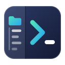
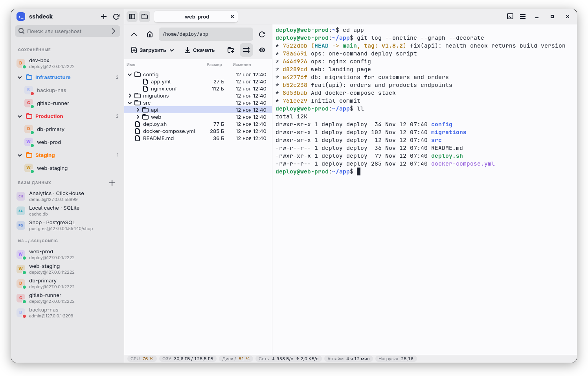
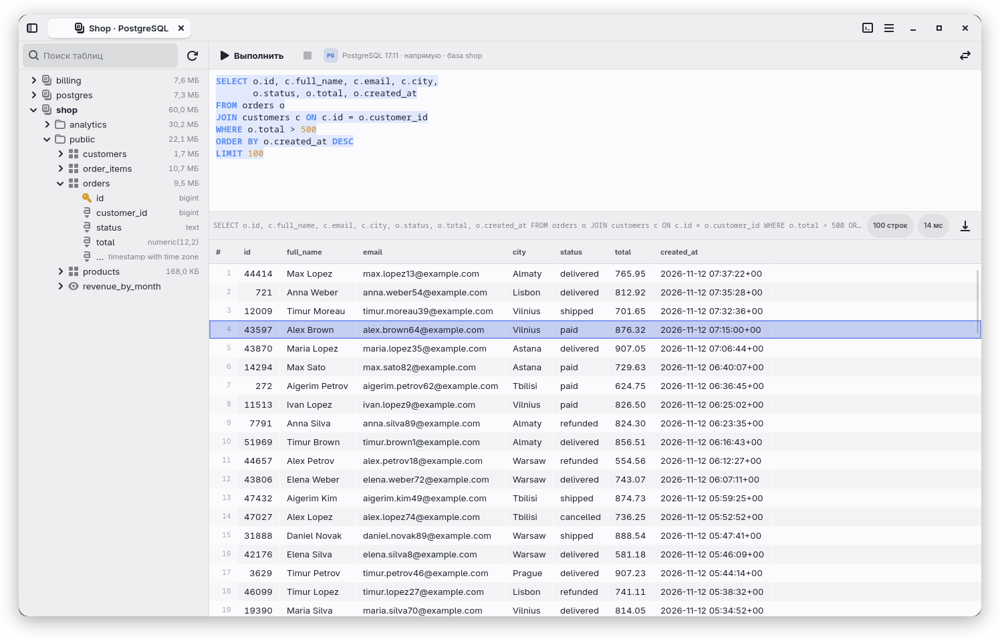
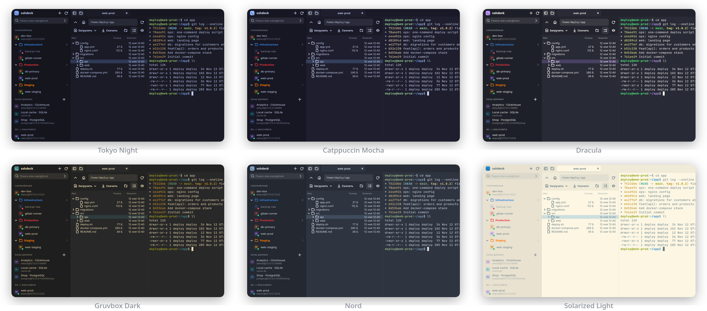
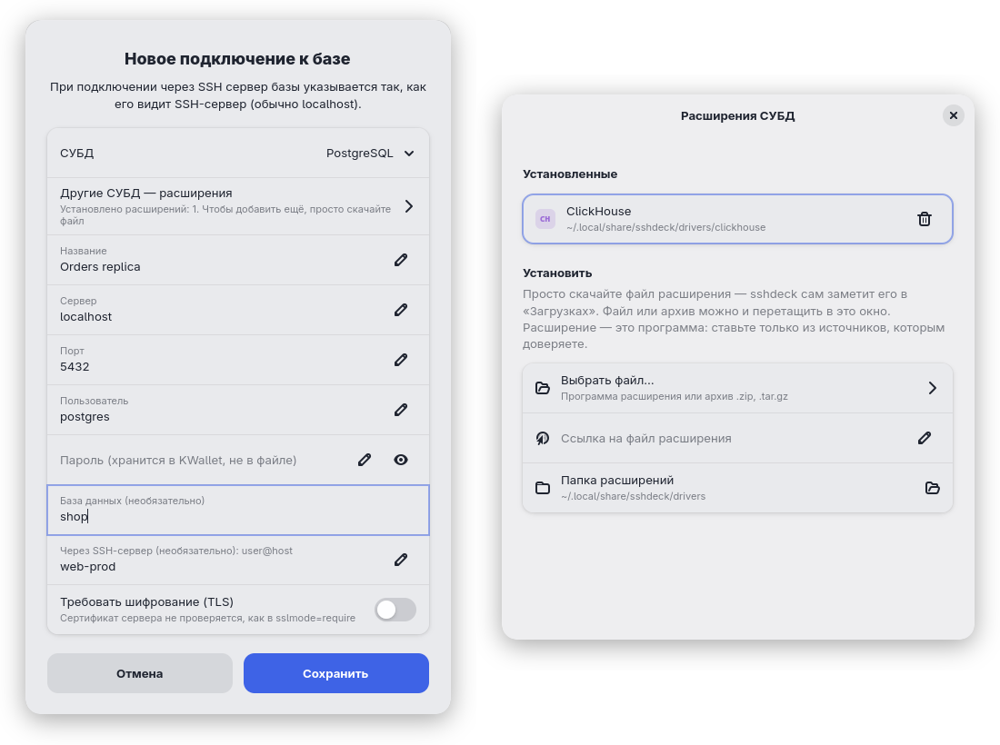

<div align="center">



# sshdeck

**Лёгкий нативный SSH-клиент для Linux: дерево файлов по SFTP, терминал и клиент баз данных в одном окне.**

[](https://www.rust-lang.org/)
[](https://gtk.org/)
[](#установка)
[](LICENSE)

[English](README.md) · **Русский**

<br>

<picture>
  <source media="(prefers-color-scheme: dark)" srcset="docs/screenshots/ru/main-dark.png">
  
</picture>

</div>

sshdeck сделан в духе MobaXterm. В каждой вкладке слева дерево файлов удалённого сервера (SFTP), справа терминал с SSH-сессией, внизу загрузка процессора, памяти и диска. Это нативное приложение на GTK 4 и libadwaita, написанное на Rust, без Electron. При этом у него своё оформление: вкладки прямо в заголовке окна, цветные значки серверов, собственные светлая и тёмная палитры.

Приложение не реализует SSH само. В терминале работает системный `/usr/bin/ssh`, поэтому `~/.ssh/config`, ключи, ssh-agent, ProxyJump и запрос пароля ведут себя так же, как в обычном терминале. Пароли и фразы ключей SSH приложение не читает, не сохраняет и не пишет в журналы.

> [!NOTE]
> Интерфейс есть на русском, английском и испанском. По умолчанию язык берётся из системы, сменить его можно в меню → «Язык». На скриншотах демонстрационные данные.

## Содержание

- [Возможности](#возможности)
- [Скриншоты](#скриншоты)
- [Установка](#установка)
- [Как пользоваться](#как-пользоваться)
- [Базы данных](#базы-данных)
- [Горячие клавиши](#горячие-клавиши)
- [Как это устроено](#как-это-устроено)
- [Файлы и настройки](#файлы-и-настройки)
- [Переводы](#переводы)
- [Ограничения](#ограничения)

## Возможности

| | |
|---|---|
| 🗂️ **Файлы и терминал рядом** | Дерево файлов слева следует за `cd` в оболочке. Перетаскивание работает в обе стороны. Файл с сервера открывается в локальном редакторе и заливается обратно при каждом сохранении. |
| 🔐 **Настоящий OpenSSH, один вход** | Пароль вводится один раз, в терминале. Панель файлов и следующие вкладки к тому же серверу используют то же соединение (`ControlMaster`), поэтому повторно его не спрашивают. |
| 🔀 **Проброс портов** | Локальные, удалённые и SOCKS-туннели через соединение вкладки, с состоянием каждого. Их можно сохранить вместе с подключением, после переподключения они поднимаются снова. |
| 🗄️ **Встроенный клиент баз данных** | PostgreSQL, MySQL/MariaDB и SQLite работают сразу, любые другие СУБД подключаются расширениями. Есть SSH-туннели, импорт и экспорт CSV/JSON/SQL, пароли хранятся в KWallet или GNOME Keyring. |
| 📁 **Порядок в подключениях** | Сохранённые подключения раскладываются по папкам, у папок бывает цвет. Хосты из `~/.ssh/config` тоже в списке, есть быстрое подключение и поиск. У каждого сервера виден значок «в сети / не в сети». |
| 📊 **Сервер как на ладони** | Строка состояния показывает CPU, память, диск, скорость сети, аптайм и среднюю нагрузку. Значения выше 75 % и 90 % подсвечиваются. |
| 🎨 **Темы** | Собственные светлая и тёмная палитры, а также Dracula, Nord, Gruvbox, Tokyo Night, One Dark, Catppuccin и Solarized. Тема перекрашивает всё приложение, а не только терминал. |
| 🌍 **Три языка** | Интерфейс на русском, английском и испанском. Собственные диалоги GTK следуют тому же выбору. |
| ⚡ **Легко и быстро** | Приложение написано на Rust, вся работа с сетью идёт в отдельном tokio-рантайме, поэтому медленная сеть не подвешивает интерфейс. |

## Скриншоты

### Клиент баз данных

<picture>
  <source media="(prefers-color-scheme: dark)" srcset="docs/screenshots/ru/database-dark.png">
  
</picture>

### Темы



### Подключение к базе и расширения

<p align="center">
  
</p>

## Установка

### Готовые пакеты

К каждому [выпуску](https://github.com/ylkhn1/sshdeck/releases/latest) приложены пакеты для x86_64. Им нужны glibc ≥ 2.39, GTK ≥ 4.16, libadwaita ≥ 1.6 и VTE ≥ 0.72; на более старых системах соберите программу из исходников.

| Система | Как поставить |
|---|---|
| Debian 13+, Ubuntu 25.04+ | `sudo apt install ./sshdeck_X.Y.Z-1_amd64.deb` |
| Fedora 42+ | `sudo dnf install ./sshdeck-X.Y.Z-1.x86_64.rpm` |
| Arch, CachyOS, Manjaro | `git clone https://github.com/ylkhn1/sshdeck && cd sshdeck/packaging/aur && makepkg -si` |
| Другие дистрибутивы x86_64 | архив `sshdeck-X.Y.Z-x86_64-linux.tar.gz`, см. ниже |

В архиве одна папка `sshdeck-X.Y.Z/`: программа, ярлык для меню, значок, этот README и лицензия. Установка для текущего пользователя (без sudo; `~/.local/bin` должен быть в `PATH`) — так установленная sshdeck умеет обновляться сама:

```sh
tar xzf sshdeck-X.Y.Z-x86_64-linux.tar.gz
cd sshdeck-X.Y.Z
install -Dm755 sshdeck ~/.local/bin/sshdeck
install -Dm644 dev.sshdeck.App.desktop ~/.local/share/applications/dev.sshdeck.App.desktop
install -Dm644 dev.sshdeck.App.svg ~/.local/share/icons/hicolor/scalable/apps/dev.sshdeck.App.svg
```

Дальше в этом разделе — сборка из исходников.

### Зависимости

| Пакет | Зачем |
|---|---|
| GTK ≥ 4.16 | интерфейс (CSS-переменные в стилях) |
| libadwaita ≥ 1.6 | вкладки, диалоги, уведомления |
| VTE ≥ 0.72 (сборка для GTK 4) | виджет терминала |
| клиент OpenSSH | `/usr/bin/ssh`, который выполняет все подключения |
| `xdg-utils` | `xdg-open` открывает файлы в локальном редакторе |
| SQLite, OpenSSL | клиент баз данных |
| Rust (edition 2024) | сборка (проверено с Rust 1.99) |

На сервере нужна SFTP-подсистема, в OpenSSH она включена по умолчанию.

**Arch / CachyOS** (на них приложение проверено):

```sh
sudo pacman -S --needed gtk4 libadwaita vte4 openssh xdg-utils sqlite openssl rust
```

<details>
<summary>Названия пакетов для Debian / Ubuntu и Fedora (не проверялось)</summary>

Нужен дистрибутив с GTK ≥ 4.16, например Debian 13 или Fedora 41 и новее.

```sh
# Debian / Ubuntu
sudo apt install libgtk-4-dev libadwaita-1-dev libvte-2.91-gtk4-dev \
                 libsqlite3-dev libssl-dev pkg-config openssh-client xdg-utils
# Fedora
sudo dnf install gtk4-devel libadwaita-devel vte291-gtk4-devel \
                 sqlite-devel openssl-devel openssh-clients xdg-utils
```

Rust удобнее всего поставить через [rustup](https://rustup.rs/).
</details>

### Сборка и запуск

```sh
git clone https://github.com/ylkhn1/sshdeck.git
cd sshdeck
cargo build --release

./target/release/sshdeck            # окно со списком хостов
./target/release/sshdeck myhost     # сразу открыть вкладку (можно несколько хостов)
```

### Установка для текущего пользователя

Ставятся бинарник, ярлык в меню приложений и значок, без sudo. `~/.local/bin` должен быть в `PATH`.

```sh
install -Dm755 target/release/sshdeck ~/.local/bin/sshdeck
install -Dm644 data/dev.sshdeck.App.desktop ~/.local/share/applications/dev.sshdeck.App.desktop
install -Dm644 data/dev.sshdeck.App.svg ~/.local/share/icons/hicolor/scalable/apps/dev.sshdeck.App.svg
update-desktop-database ~/.local/share/applications
```

### Проверки

```sh
cargo test                  # юнит-тесты (разбор ~/.ssh/config, команды ssh, пути, SQL, форматы)
cargo clippy --all-targets  # без предупреждений
```

## Как пользоваться

### Подключения

- **Быстрое подключение.** В поле вверху боковой панели можно ввести адрес вручную: `user@host` или псевдоним. Порт задаётся как в `ssh` (`user@host -p 2222`) либо через двоеточие (`user@host:2222`, `ssh://user@host:2222`). Другие параметры `ssh` в этом поле не принимаются.
- **Сохранённые подключения.** Кнопка **+** сохраняет подключение: название, адрес и необязательная папка. Двойной щелчок открывает вкладку с этим названием. Правая кнопка мыши: подключиться, изменить, дублировать, удалить. Запись из `~/.ssh/config` тоже можно сохранить через её контекстное меню.
- **Папки.** Папки бывают вложенными, например `Работа/Серверы`. Папка появляется, когда в неё сохранено первое подключение, и исчезает вместе с последним. Щелчок по папке сворачивает её; свёрнутые папки остаются свёрнутыми после перезапуска. В контекстном меню папки: новое подключение в ней, переименование, цвет (семь цветов), «Убрать папку, оставив подключения» (содержимое поднимается на уровень выше) и удаление вместе со всем содержимым.
- **Порядок.** Подключения и папки стоят в том порядке, который задали вы. Их можно перетаскивать в боковой панели, а в контекстном меню есть «Переместить выше», «Переместить ниже» и «Переместить в папку…».
- **Хосты из `~/.ssh/config`.** Ниже идут записи `Host` из `~/.ssh/config` (без масок, с учётом `Include`). Двойной щелчок открывает вкладку.
- **Поиск.** Текст в поле вверху боковой панели заодно фильтрует список подключений по названию, адресу и папке. Найденное показывается внутри своих папок.
- **Значки доступности.** Приложение проверяет каждый сервер по приветствию `SSH-…`, не входя на него. В подсказке видна задержка.
- **Команда после входа.** В диалоге подключения можно задать команду, которая выполнится в терминале сразу после входа (например, `cd /srv/app`).
- **Сохранённые команды.** Кнопка с терминалом в заголовке окна открывает список команд. Щелчок набирает команду в терминале текущей вкладки и нажимает Enter. Набранное в терминале приложение не записывает, потому что туда попадали бы пароли.
- **Импорт и экспорт.** «Меню → Экспорт подключений…» сохраняет все сохранённые подключения и папки вместе с цветами, командами после входа и пробросами портов в JSON-файл; паролей в нём нет. «Меню → Импорт подключений…» добавляет подключения из такого файла или из конфига ssh с другой машины (из него берутся только адрес, пользователь и порт). Подключение с тем же названием и адресом в той же папке пропускается, поэтому повторный импорт того же файла ничего не добавляет.

### Файлы

- **Вход.** Пароль или фраза ключа вводятся один раз, в терминале вкладки. Панель файлов ждёт и подключается сама, как только вход выполнен. Следующие вкладки к тому же серверу используют этот вход. Вкладка, открытая, пока в другой ещё идёт вход, ждёт его и пароль повторно не спрашивает (Enter — войти в ней самостоятельно).
- **Дерево файлов.** Дерево стартует в домашнем каталоге. Стрелка раскрывает каталог на месте, а его содержимое подгружается при раскрытии. Двойной щелчок по каталогу переходит в него. В поле пути можно вписать путь вручную (`~`, `..` и относительные пути понимаются). Кнопка с глазом показывает файлы с точкой.
- **Операции.** Кнопки над списком и контекстное меню: загрузить файлы или каталог, скачать выбранное, создать каталог, переименовать (F2), удалить (Delete, с подтверждением), обновить (F5 или Ctrl+R). Каталоги передаются и удаляются рекурсивно. Перед заменой существующих файлов приложение спрашивает.
- **Перетаскивание.** Файлы из файлового менеджера можно бросить на папку в дереве — они загрузятся в неё, — или в любое другое место панели — тогда в текущий каталог. Строки панели можно перетащить в файловый менеджер, и они скачаются.
- **Файлы этого компьютера.** Кнопка с **компьютером** вверху панели показывает дерево локальных файлов над деревом сервера; границу между ними можно перетаскивать. Выберите файлы в одном дереве и нажмите F5 (или кнопку копирования, или «Загрузить на сервер» / «Скачать в локальный каталог» в контекстном меню), чтобы скопировать их в каталог, открытый в другом дереве, — или перетащите их из одного дерева в другое. В локальном дереве можно открывать файлы и каталоги, создавать каталоги, переименовывать (F2), перемещать в корзину (Delete) и копировать путь; насовсем оно ничего не удаляет. Оно открывается в каталоге, где вы были в прошлый раз с этим сервером, а состояние кнопки общее для всех вкладок и сохраняется после перезапуска.
- **Передачи.** Для каждой передачи видны прогресс и кнопка отмены. Отменённая передача не оставляет недописанных файлов. Время изменения сохраняется в обе стороны, новые файлы на сервере получают права локального файла, а скачанные файлы и каталоги — права, которые у них на сервере (без записи для группы и остальных). Символические ссылки на каталоги раскрываются (с защитой от циклов), спецфайлы пропускаются с уведомлением. Имена не в UTF-8 тоже работают.
- **Правка файла.** Двойной щелчок по файлу скачивает его и открывает через `xdg-open`. При каждом сохранении в редакторе файл заливается обратно на сервер, пока открыта вкладка. Если за это время файл изменился на сервере, приложение спросит, что делать: перезаписать, сохранить вашу версию копией рядом или оставить её у себя.
- **Панель следует за `cd`.** Когда оболочка на сервере сообщает текущий каталог, панель файлов переходит следом. fish делает это сам. Для bash и zsh это включается пунктом меню «Слежение панели за cd на этом сервере…»: в `~/.bashrc` или `~/.zshrc` на сервере дописываются несколько строк с пометкой `sshdeck-cwd`; если вы включали это в прежней версии, выберите пункт ещё раз, чтобы обновить их. Пути с пробелами и кириллицей работают. Если с сервера зайти на другой сервер, панель останется на месте и сообщит об этом. Обратное действие — «Перейти сюда в терминале» в меню файла.

### Терминал

- Ctrl+Shift+C / Ctrl+Shift+V — копирование и вставка. Ctrl и «+», «−», «0» меняют масштаб.
- Ссылки и IP-адреса подчёркиваются под указателем. Ctrl+щелчок открывает ссылку в браузере, а адрес копирует.
- ssh проверяет связь каждые 30 секунд, чтобы сессия не обрывалась при простое.
- Когда `ssh` завершается штатно (`exit`), вкладка закрывается. При ошибке соединения она остаётся открытой с кнопкой «Переподключиться».
- **Разделение терминала.** Ctrl+Shift+E открывает ещё один терминал справа от текущего, Ctrl+Shift+O — под ним, Ctrl+Shift+W закрывает текущий (те же пункты есть в меню). После входа новый терминал идёт через соединение вкладки и пароль повторно не спрашивает. Команды, сниппеты и «Перейти сюда в терминале» уходят в терминал, по которому щёлкнули последним, и панель файлов следует за его каталогом. `exit` в одной из частей закрывает только её.
- **Вход без пароля.** Меню → «Вход без пароля (ключ) для этой вкладки…». Сначала нужно войти на сервер в терминале вкладки. Приложение берёт тот ключ, которым ssh будет входить на этот сервер: `IdentityFile` хоста из `~/.ssh/config`, если он задан, иначе ваш ключ по умолчанию (`id_ed25519`, `id_ecdsa` или `id_rsa`). Если такого ключа ещё нет, он создаётся. Открытая часть дописывается в `~/.ssh/authorized_keys` на сервере (повторно ключ не добавляется), после чего приложение проверяет, что вход по ключу действительно работает. Пароль при этом через приложение не проходит.

### Проброс портов

- Меню → «Проброс портов для этой вкладки…» добавляет локальные (`-L`), удалённые (`-R`) и динамические SOCKS-туннели (`-D`) через соединение вкладки. У каждого видно, работает ли он, а если нет — почему (например, порт занят). Локальный туннель можно скопировать как `localhost:ПОРТ` или открыть в браузере.
- Туннели принадлежат соединению: вкладки к одному серверу пользуются ими вместе, после переподключения они поднимаются снова. Значок на вкладке показывает их состояние и открывает окно.
- Туннель можно сохранить вместе с подключением — из этого окна или в поле «Проброс портов» диалога подключения, например `-L 8080:localhost:80, -D 1080`. Сохранённые туннели поднимаются сами при подключении.

### Темы

Меню → «Тема»: как в системе, светлая, тёмная или одна из цветных тем. «Как в системе», «Светлая» и «Тёмная» используют собственную палитру sshdeck, а не стандартные серые цвета GNOME. «Как в системе» следует за светлым или тёмным режимом системы. Цветная тема перекрашивает заголовок, боковую панель, списки, диалоги и терминал. Шрифт терминала выбирается в меню → «Шрифт терминала…».

### Обновления

Раз в сутки — через несколько секунд после запуска и потом каждые 24 часа работы — sshdeck спрашивает у GitHub, какой выпуск последний (`https://api.github.com/repos/ylkhn1/sshdeck/releases/latest`). Личных данных в запросе нет, только заголовок User-Agent `sshdeck/<версия>`; IP-адрес GitHub видит, как и при любой загрузке. Пред-выпуски не предлагаются. Если вышла новая версия, под заголовком окна появляется полоса с кнопкой обновления, а в её меню ⋯ — «Что нового» (страница выпуска) и «Пропустить эту версию». Меню → «Проверить обновления…» проверяет сразу (и показывает пропущенную версию); меню → «Проверять обновления автоматически» выключает ежедневную проверку — тогда sshdeck никуда не обращается.

Что делает кнопка «Обновить», зависит от того, как sshdeck установлена:

| Откуда установлена | Обновление |
|---|---|
| архив `.tar.gz` в свою папку (например, `~/.local/bin`) | sshdeck скачивает новый архив, проверяет подпись и заменяет свой файл. Запущенная копия продолжает работать; «Перезапустить» открывает новую версию (открытые сессии закроются), иначе она запустится в следующий раз. |
| `.deb` / `.rpm` | sshdeck скачивает пакет и проверяет подпись, затем «Установить» запускает `pkexec apt-get install` / `pkexec dnf install` с запросом пароля. Если так не получается, показывает команду для терминала. |
| PKGBUILD (Arch) | sshdeck только сообщает о новой версии и показывает команду: `git pull && cd packaging/aur && makepkg -si` в вашей копии репозитория. |
| сборка из исходников и всё остальное | sshdeck только сообщает о новой версии и даёт ссылку на страницу выпуска. |

Все файлы выпуска подписаны [minisign](https://jedisct1.github.io/minisign/), открытый ключ встроен в программу. Файл, подпись которого не сходится, подписанный для другого имени или версии или скачанный не из выпусков этого репозитория на GitHub, не устанавливается.

## Базы данных

Встроенный клиент баз данных в духе DBeaver: PostgreSQL, MySQL/MariaDB и SQLite сразу, любые другие СУБД через расширения.

- **Подключения** находятся в разделе «Базы данных» в левой панели. Подключение может идти через SSH-сервер: туннель поднимается сам, через открытую вкладку с этим сервером или по ключу.
- **Пароли** хранятся в системном хранилище (KWallet, GNOME Keyring), не в файле. Если сервер не принял сохранённый пароль, окно ввода откроется само.
- **Дерево.** Базы сервера → схемы → таблицы и представления → колонки (ключ отмечает первичный ключ). Рядом с таблицей указан её размер на диске вместе с индексами, у схемы и базы — общий размер. В подсказке видно примерное число строк. Двойной щелчок по базе делает её активной.
- **Запросы.** Ctrl+Enter выполняет запрос под курсором или выделение, Ctrl+Shift+Enter — весь текст. Двойной щелчок по таблице показывает первые 200 строк, по строке результата — её целиком.
- **Экспорт.** Правая кнопка на таблице → «Экспорт данных…» выгружает все строки в CSV, CSV для Excel (`;`, BOM), JSON или SQL (`INSERT`). Таблица выгружается потоком, не загружаясь в память. Кнопка над результатом сохраняет показанный результат.
- **Импорт.** Загружает CSV/TSV (разделитель определяется сам) или JSON-массив объектов. Колонки сопоставляются по именам из первой строки. Пустое поле становится NULL, `""` остаётся пустой строкой. Загрузка идёт одной транзакцией, поэтому при ошибке таблица не меняется. Можно сначала очистить таблицу.
- **Расширения.** Драйвер другой СУБД — отдельная программа на любом языке. Ставить руками ничего не нужно: скачайте файл расширения (или архив `.zip`/`.tar.gz`), и sshdeck сам заметит его в «Загрузках» и предложит установить. Ещё можно выбрать файл, перетащить его в окно или вставить ссылку (подойдёт и ссылка на страницу файла на GitHub). Расширения лежат в `~/.local/share/sshdeck/drivers/`. Пример — [драйвер ClickHouse](extensions/clickhouse/sshdeck-driver-clickhouse) на Python 3 без зависимостей. Протокол (строки JSON через stdin/stdout) описан в [extensions/README.md](extensions/README.md).

## Горячие клавиши

| Где | Клавиши | Действие |
|---|---|---|
| Терминал | <kbd>Ctrl</kbd>+<kbd>Shift</kbd>+<kbd>C</kbd> / <kbd>V</kbd> | Копировать / вставить |
| Терминал | <kbd>Ctrl</kbd>+<kbd>+</kbd> / <kbd>−</kbd> / <kbd>0</kbd> | Крупнее / мельче / исходный масштаб |
| Терминал | <kbd>Ctrl</kbd>+щелчок | Открыть ссылку / скопировать IP-адрес |
| Терминал | <kbd>Ctrl</kbd>+<kbd>Shift</kbd>+<kbd>E</kbd> / <kbd>O</kbd> | Разделить терминал вправо / вниз |
| Терминал | <kbd>Ctrl</kbd>+<kbd>Shift</kbd>+<kbd>W</kbd> | Закрыть текущий терминал разделённой вкладки |
| Файлы | <kbd>F2</kbd> | Переименовать |
| Файлы | <kbd>Delete</kbd> | Удалить (с подтверждением); в локальном дереве — переместить в корзину |
| Файлы | <kbd>F5</kbd> | Обновить; если показано локальное дерево — скопировать выбранное в другое дерево |
| Файлы | <kbd>Ctrl</kbd>+<kbd>R</kbd> | Обновить |
| Редактор SQL | <kbd>Ctrl</kbd>+<kbd>Enter</kbd> | Выполнить запрос под курсором или выделение |
| Редактор SQL | <kbd>Ctrl</kbd>+<kbd>Shift</kbd>+<kbd>Enter</kbd> | Выполнить весь текст |

## Как это устроено

```
┌─────────────── вкладка ──────────────┐
│  Терминал VTE                        │      ssh -o ControlMaster=auto
│    └─ /usr/bin/ssh ──────────────────┼────► -o ControlPath=$XDG_RUNTIME_DIR/sshdeck/<сервер>
│                                      │      (вход выполняется здесь, один раз)
│  Панель файлов                       │
│    └─ ssh -S <сокет> -s host sftp ───┼────► через то же мастер-соединение
│  Строка состояния                    │
│    └─ ssh -S <сокет> host <команда> ─┼────► читает /proc раз в 3 секунды
└──────────────────────────────────────┘
```

- Вкладки к одному и тому же пользователю, хосту и порту делят один управляющий сокет в `$XDG_RUNTIME_DIR/sshdeck/` (каталог с правами 0700).
- Панель файлов сама не аутентифицируется. Она периодически выполняет `ssh -O check`, а когда мастер-соединение поднялось, запускает через него подсистему `sftp` и говорит с ней собственным небольшим клиентом SFTP v3 (`src/sftp/proto.rs`). Он хранит имена файлов как байты и не доверяет ничему, что присылает сервер: имена, которые могли бы вывести за пределы выбранной папки, отбрасываются, размеры пакетов, глубина обхода и время ожидания ограничены.
- Туннели добавляются в мастер командой `ssh -O forward` и снимаются `-O cancel`, с `-F /dev/null`, чтобы не задеть пробросы из вашего `~/.ssh/config`.
- `ControlPersist=10` нужен, чтобы `ssh` в терминале завершался сразу после `exit`. Закрытие вкладки завершает только её ssh; мастер гасится (`ssh -O exit`), когда закрывается последняя вкладка к этому серверу. После аварийного завершения мастер исчезает через 10 секунд простоя.
- Вся работа с сетью идёт в отдельном tokio-рантайме и общается с потоком GTK через каналы.
- Временные файлы (правка, перетаскивание) лежат в `$XDG_RUNTIME_DIR/sshdeck/files-<pid>-<вкладка>/` и удаляются при закрытии вкладки. Остатки после аварийного завершения убираются при следующем запуске.

<details>
<summary>Структура исходников</summary>

```
src/
  main.rs          запуск приложения
  i18n.rs          переводы интерфейса: макросы tr!/trn!, встроенные каталоги .po
  ssh_config.rs    разбор ~/.ssh/config для списка хостов
  connections.rs   сохранённые подключения, вложенные папки, порядок, цвета, туннели
  forward.rs       проброс портов: описания, проверка, общие счётчики ссылок
  probe.rs         проверка доступности сервера (приветствие SSH, без входа)
  keysetup.rs      вход без пароля: создание ключа и установка на сервер
  remote.rs        команды на сервере через мастер-соединение вкладки
  sysstat.rs       разбор показателей сервера для строки состояния
  session.rs       управляющий сокет и командные строки ssh
  settings.rs      настройки: шрифт, темы, сохранённые команды
  sftp/            свой клиент SFTP v3, фоновая задача, рекурсивные передачи с прогрессом и отменой
  ui/window.rs     главное окно: вкладки, меню
  ui/hosts.rs      боковая панель: подключения, вложенные папки и порядок перетаскиванием, хосты из ssh-конфига, базы
  ui/forwards.rs   окно проброса портов и значок на вкладке
  ui/tab.rs        вкладка: панель файлов + терминал
  ui/terminal.rs   терминал VTE, темы, подсветка ссылок и адресов
  ui/files.rs      панель файлов
  ui/statusbar.rs  строка состояния сервера
  ui/dbtab.rs      вкладка базы: дерево, редактор SQL, результаты
  ui/databases.rs  подключения к базам, диалог, пароли
  ui/extensions.rs окно «Расширения СУБД»: установка и удаление
  db/driver.rs     драйверы PostgreSQL, MySQL, SQLite и расширений
  db/extension*    поиск расширений, протокол, установка
  db/transfer.rs   форматы экспорта и импорта (CSV, JSON, SQL)
  db/tunnel.rs     SSH-туннель к серверу базы
  db/sql.rs        разбор SQL: запрос под курсором, подсветка, кавычки
  db/secrets.rs    пароли в системном хранилище
extensions/        расширения-драйверы (пример: ClickHouse) и протокол
po/                переводы на русский и испанский (gettext .po)
```
</details>

## Файлы и настройки

| Путь | Что там |
|---|---|
| `~/.config/sshdeck/settings.ini` | шрифт и тема терминала, оформление окна, язык интерфейса, сохранённые команды, проверка обновлений (`[updates]`: `check`, время последней проверки, пропущенная версия) |
| `~/.config/sshdeck/connections.ini` | сохранённые подключения, вложенные папки, их порядок и цвета, сохранённые туннели. Паролей в нём нет, файл можно править вручную и переносить на другую машину. Файлы прежних версий читаются как есть. |
| `~/.config/sshdeck/databases.ini` | подключения к базам (без паролей) |
| `~/.local/state/sshdeck/local-folders.ini` | последний локальный каталог для каждого сервера |
| `~/.local/share/sshdeck/drivers/` | установленные расширения СУБД |
| `~/.cache/sshdeck/updates/` | скачанное обновление, пока оно ставится; потом удаляется |

Переменная окружения `SSHDECK_SSH_CONFIG=<файл>` заменяет `~/.ssh/config`: из файла берётся список хостов, и он же передаётся всем вызовам `ssh` через `-F`.

## Переводы

Строки в коде написаны по-английски и обёрнуты в `tr!("…")`, а если текст зависит от числа — в `trn!`. Переводы лежат в [`po/ru.po`](po/ru.po) и [`po/es.po`](po/es.po). Это обычные каталоги gettext, их открывает любой редактор `.po`, например Poedit или Lokalize. Каталоги встраиваются в бинарник, отдельно ставить ничего не нужно.

`cargo test` проверяет, что у каждой строки из кода есть перевод в каждом каталоге, что в каталогах нет неиспользуемых записей и что плейсхолдеры `{}` совпадают. Чтобы добавить язык, скопируйте `po/es.po`, переведите его и зарегистрируйте язык в `src/i18n.rs`.

## Ограничения

<details>
<summary>Это первая версия. Раскройте, чтобы увидеть, чего она пока не умеет.</summary>

- Только Linux, нет X11-форвардинга. Пароли хранятся только для баз данных; пароли SSH не сохраняются намеренно.
- Слова вроде error и warning в выводе терминала не перекрашиваются: VTE этого не умеет. Подсвечиваются только ссылки и IP-адреса под указателем.
- Ключ дописывается в `~/.ssh/authorized_keys`. Если sshd на сервере читает ключи из другого файла, приложение может только сообщить, что вход по ключу всё ещё не работает.
- SFTP передаёт время с точностью до секунды, поэтому изменение на сервере в ту же секунду и без смены размера при сохранении из редактора не заметно.
- «Перейти сюда в терминале» для каталогов, в именах которых есть байты не из UTF-8, требует fish 3.4 или новее, если на сервере fish (bash, zsh и sh подходят).
</details>

## Лицензия

[MIT](LICENSE).
